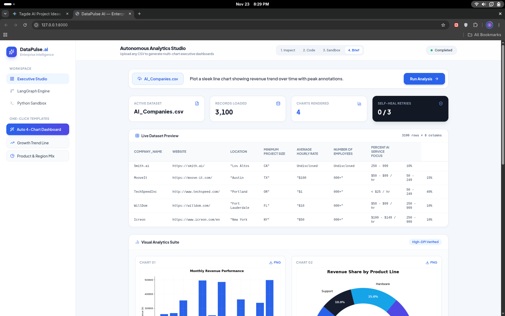

cat << 'EOF' > README.md
<div align="center">

# ⚡ DataPulse AI — Autonomous Analytics Studio

**Self-Healing Multi-Agent Data Analyst powered by LangGraph, FastAPI & OpenRouter**

[](https://python.org)
[](https://fastapi.tiangolo.com)
[](https://langchain-ai.github.io/langgraph/)
[](https://openrouter.ai)
[](https://pandas.pydata.org)
[](https://matplotlib.org)
[](LICENSE)

[Quick Start](#quick-start) · [Features](#features) · [Architecture](#architecture) · [Tech Stack](#tech-stack) · [Deploy Live](#deploy-live)

*Upload any raw CSV. Ask a question in plain English. Get verified Python execution, high-DPI executive charts, and a boardroom-ready brief — with zero hallucinations.*

</div>

---

## Features

* **Zero-Hallucination Execution:** Never guesses numbers from raw CSV text — writes and executes real `pandas` + `matplotlib` Python scripts in an isolated subprocess sandbox.
* **Autonomous Self-Healing (Up to 3x Retries):** If generated code hits a `SyntaxError`, `KeyError`, or `ValueError`, the traceback is automatically routed back to the Coder Node to patch and re-run without user intervention.
* **Dynamic OpenRouter LLM Routing:** Automatically discovers active `:free` models on OpenRouter with empty-response guards and instant fallback on rate limits (`429` / `404`).
* **Real-Time WebSocket Streaming:** Streams live step-by-step agent progress (`1. Inspect → 2. Code → 3. Sandbox → 4. Brief`) directly to the browser UI.
* **Executive Visual Suite:** Renders multi-chart `160 DPI` dashboards (Bar, Donut, Horizontal Bar, Trend Line) with downloadable PNGs and a structured Executive Brief.

<div align="center">
  
  <br />
  <em>DataPulse AI — Live CSV profiling, KPI cards, and one-click analytics templates.</em>
</div>

<br />

<div align="center">
  
  <br />
  <em>High-DPI 4-chart executive dashboard generated autonomously via Matplotlib.</em>
</div>

<br />

<div align="center">
  
  <br />
  <em>Verified Executive Brief alongside the live LangGraph Execution & Self-Healing Log.</em>
</div>

---

## Why This Exists

Most AI data tools dump CSV rows straight into an LLM prompt, leading to **context-window limits and hallucinated math**. DataPulse AI separates reasoning from computation: the LLM only inspects the schema and writes Python code, while an isolated Python sandbox computes exact metrics and renders publication-grade visuals.

---

## Architecture

```mermaid
flowchart LR
    A[CSV Upload + Prompt] --> B[1. Inspector Node]
    B -->|Schema & Sample| C[2. Coder Node]
    C -->|Python Script| D[3. Sandbox Executor]
    D -->|Error & Retries < 3| C
    D -->|Verified Stdout + PNGs| E[4. Executive Strategist]
    E --> F[Live UI via WebSockets]