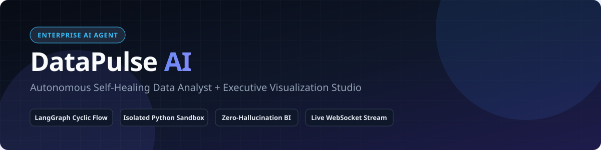
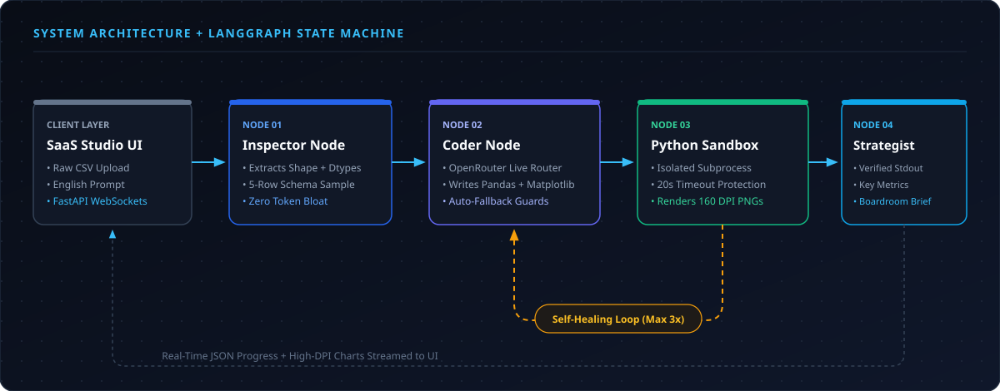
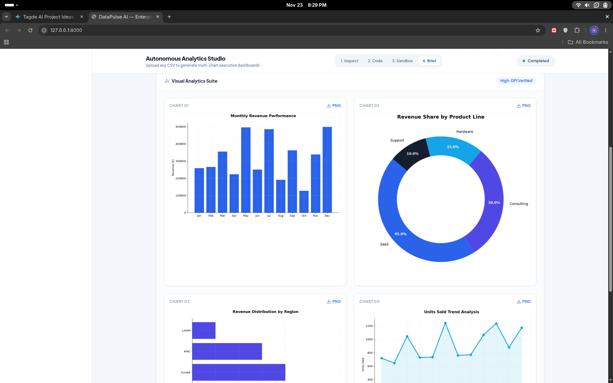
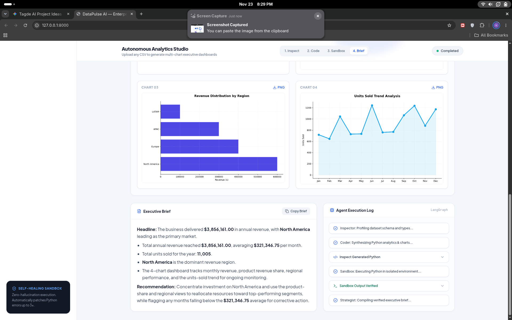

<div align="center">



<br /><br />

[](https://python.org)
[](https://fastapi.tiangolo.com)
[](https://langchain-ai.github.io/langgraph/)
[](https://openrouter.ai)
[](https://pandas.pydata.org)
[](https://matplotlib.org)
[](LICENSE)

[Architecture](#architecture) · [Product Showcase](#product-showcase) · [Why This Exists](#why-this-exists) · [Tech Stack](#tech-stack) · [Quick Start](#quick-start)

</div>

---

## Architecture

<div align="center">
  
</div>

### Execution Pipeline
1. **Inspector Node (`agent/nodes.py`):** Profiles the uploaded CSV (`df.shape`, `df.dtypes`, `df.head(5)`) so the LLM understands the exact schema without overflowing the context window.
2. **Coder Node (`agent/nodes.py`):** Uses dynamic OpenRouter model discovery to synthesize a standalone `pandas` + `matplotlib` script styled in a clean executive palette (`160 DPI`).
3. **Self-Healing Python Sandbox (`executor_node`):** Runs the script in an isolated subprocess with a 20-second timeout. If a `SyntaxError`, `KeyError`, or `ValueError` occurs, the traceback loops back to the Coder Node for up to **3 autonomous self-healing retries**.
4. **Executive Strategist (`summarizer_node`):** Generates a boardroom-ready brief (headline, bold KPIs, actionable recommendation) strictly from verified terminal stdout.

---

## Product Showcase

### 1. Autonomous Analytics Studio & Live Data Profiler
<div align="center">
  
</div>

### 2. Multi-Chart Visual Analytics Suite (160 DPI)
<div align="center">
  
</div>

### 3. Verified Executive Brief & LangGraph Execution Log
<div align="center">
  
</div>

---

## Why This Exists

| Capability | Standard Chat-with-CSV Tools | DataPulse AI |
| :--- | :--- | :--- |
| **Math & Aggregations** | Prone to LLM token-prediction hallucinations | **100% deterministic Python (`pandas`) execution** |
| **Large Datasets** | Fails on context-window token limits | **Profiles schema only — scales to thousands of rows** |
| **Runtime Bugs** | Crashes and exposes raw tracebacks to user | **Autonomous 3x self-healing code patching** |
| **Visual Output** | Basic single static plots | **Multi-chart 160-DPI executive dashboards** |

---

## Tech Stack

| Layer | Technology | Role |
| :--- | :--- | :--- |
| **Backend & Streaming** |  `Uvicorn` + `WebSockets` | Async CSV upload API & real-time step streaming |
| **Agent Orchestration** |  `StateGraph` | Cyclic multi-node workflow with retry routing |
| **LLM Inference** |  `OpenAI SDK` | Live `:free` model discovery + empty-response fallback |
| **Data & Visuals** |  + `Matplotlib (Agg)` | Headless data processing & publication-grade PNGs |
| **Frontend** |    | Stripe/Linear-inspired SaaS UI with live step tracker |

---

## Quick Start

```bash
git clone [https://github.com/theutkarshnode/datapulse-ai.git](https://github.com/theutkarshnode/datapulse-ai.git)
cd datapulse-ai

python -m venv venv
source venv/bin/activate
pip install -r requirements.txt

export OPENROUTER_API_KEY="sk-or-v1-your-key-here"
uvicorn app:app --reload
```

Open **`http://127.0.0.1:8000`** in your browser.

---

## License

Released under the [MIT License](LICENSE).